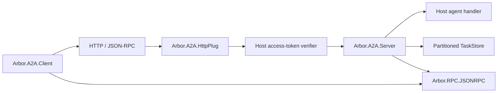

# Architecture

The OTP application starts a bounded `Arbor.A2A.Executor` task supervisor.
Hosts own the HTTP listener and one or more supervised `Arbor.A2A.TaskStore`
processes. A `Server` struct binds an agent handler, store, card, tenant and
callback deadline. Server callbacks execute concurrently and have no implicit
mutable handler state.

For tenant-routed interfaces, configure the same tenant string in the card's
`supportedInterfaces` entry and `Server`'s `:tenant` option. Explicit clients
also pass `tenant: value` to `Client.new/2`; that value is included in every
request. Host routing and stable authenticated principal identifiers determine
the partition. A card's tenant declaration alone does not configure a server.

The client is an immutable connection configuration, not an owner of global
token/session state. Requests acquire a token from the host when configured,
open one HTTP connection, preserve a finite network deadline, verify response
IDs and close the connection. Calls are never retried automatically; a timeout
has an unknown remote outcome. Discovery sends no token and rejects a selected
interface on another origin. URLs are explicit host configuration; the Mint
boundary is not a DNS-pinned public-network SSRF filter. Hosts must apply their
outbound network policy to untrusted inputs.

The Plug authenticates before reading an RPC body, imposes a request size bound,
and returns authentication failures at the HTTP layer. Valid A2A/RPC calls
return typed JSON-RPC results/errors. Hosts configure HTTPS, access controls,
reverse-proxy trust and listener binding. A public card is served separately
with a cache lifetime; signed/extended card support is not implemented.

`TaskStore` partitions records by `{principal, tenant}`. It bounds entry count
(1,000 by default), per-task JSON size (64 KiB) and TTL (one hour). Terminal
tasks cannot be overwritten with another state or context. Page tokens are
HMAC-protected and bind the caller, filters and cursor to one store lifetime.
Pagination orders by newest status timestamp with task ID as a stable tie-break;
tasks without timestamps follow timestamped tasks. Cursors retain that sort
key. This is a live view, not a consistent snapshot. Expiration is lazy
on store operations. Restart discards records and token keys. Durable storage,
resource quotas across services and distributed execution remain future work.

An agent callback receives server-assigned task/context IDs, any prior task,
and trusted caller/tenant context. It may return a direct agent message or a
task. A blocking send must return a terminal/interrupted task; nonblocking mode
may acknowledge an in-progress task. Hosts own the actual background execution
and subsequent calls to the store. The library does not create a durable job
from a task record. Cancellation calls the optional host `handle_cancel/2`
first, and records cancellation only after its acknowledgement; without that
callback the task is not cancelable. Callback workers have deadlines even if
their request caller disappears. Stopping a callback cannot undo external side
effects or substitute for cancellation of host-owned work.

This first slice deliberately keeps the stateful task store separate from the
agent callback and the listener. A2A streaming, subscription coordination,
durability and further validation will build on these explicit boundaries.
