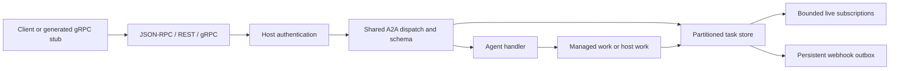

# Architecture

The application supervises a bounded executor, subscription coordinator and
webhook dispatcher. The host supervises task stores and HTTP/gRPC listeners.
A `Server` binds a handler, store, public card, optional extended card, tenant,
webhook policy and callback deadline. Listener configuration remains explicit.

All task and configuration access uses `{principal, tenant}`. Principals must
be stable authenticated identities for persistent stores. Configure a card's
interface tenant and the server's tenant consistently. The client sends its
configured tenant on every call; REST also routes it through the URL prefix.
Application authorization beyond identity/tenant partitioning remains a host
duty. Unauthenticated access uses the shared `:anonymous` identity.

The immutable HTTP client opens and closes an owned socket per operation.
Credentials are obtained per call, omitted from discovery and redacted from
inspection. TLS verifies the URL hostname; optional client certificates and
custom trust roots cannot disable peer verification. The finite request client
and synchronous streaming reducer impose deadlines and byte/event bounds.
Halting a streaming reducer closes its socket. Calls are not automatically
retried: a timeout has an unknown business outcome.

The JSON-RPC binding reuses ArborRPC. Schema-aware request/result validation
uses generated types from the pinned canonical proto, retains arbitrary
Struct/Value keys, accepts protobuf field aliases, enum numbers, integer strings
and base64 alphabets, and ignores unknown fields for forward compatibility.
Alternate spellings of a known field in one object are rejected. Required field
annotations and A2A roles, identities, history and state semantics are checked
in addition to protobuf scalar types.

Handlers return a direct message, a task, a typed error, or
`{:async, fn context -> result end}`. A per-task lease rejects concurrent/stale
message execution. Managed jobs are supervised and bounded; blocking sends wait
for terminal/interrupted state, while `returnImmediately` acknowledges submitted
work. Owned cancellation kills that worker. Host-owned work instead requires
`handle_cancel/2` acknowledgement before cancellation is stored. Stopping a
worker cannot undo external side effects.

`Server.emit/2` accepts an initial Task or subsequent status/artifact updates
using the context's trusted task and context identities. Artifact appends are
assembled in storage. Persistence commits before subscribers see updates.
Subscriptions atomically capture a snapshot and then consume live updates.
Queues default to 64 events, with 1,000 subscriptions globally; slow consumers
are disconnected. Reader exits release subscriptions without canceling work.
There is no replay or exactly-once stream delivery guarantee.

The store defaults to 1,000 tasks, 64 KiB per task and a one-hour TTL. It rejects
context replacement and terminal-state regression. Listing orders newest status
first with nanosecond precision, task ID tie-break and missing timestamps last.
Authenticated cursor tokens bind filters and caller identity. Pagination is a
live view, not a snapshot.

Persistence adapters implement `TaskStore.Persistence`. The supplied file
adapter writes private, synchronously flushed atomic snapshots and permits one
live owner per path. It retains tasks, cursor keys, webhook configs and up to
1,000 pending outbox jobs. Restart fails abandoned managed work instead of
replaying side effects. It does not provide distributed consensus, automatic
business retries or multi-writer storage. Hosts needing those properties supply
an adapter and an execution policy appropriate to their deployment.

Webhook configuration is task-owner scoped and limited to ten configs per task.
Updates enter the outbox in the same commit as task state. Delivery is serialized
per store with bounded global concurrency; each job has at most three attempts.
Receivers must tolerate duplicates across crashes. A restarted dispatcher rediscovers live stores and resumes pending outboxes.
Delivery failure emits
`[:arbor_a2a, :push, :delivery]` telemetry. The default policy permits public
HTTPS destinations, re-resolves on each attempt and pins the checked address
while preserving TLS hostname verification. Redirects are rejected. Explicit
private-network policies belong to trusted host configuration and are not
persisted as executable functions.

Public discovery is separate from authenticated operations. Extended cards
require an authenticated principal. Required extensions use exact URI/version
negotiation; active URIs enter handler context. Hosts implement the semantics of
the extensions they advertise. Optional card signatures use JOSE and JCS with
host-supplied keys and allowed asymmetric algorithms; card-supplied key URLs are
never fetched. gRPC and signing dependencies are optional for package consumers.
